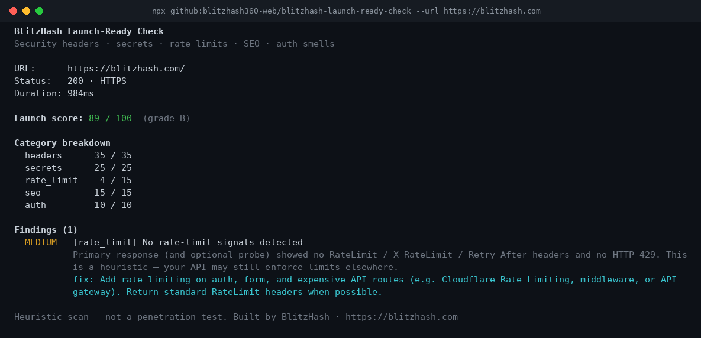

# BlitzHash Launch-Ready Check

**Scan a live URL before launch: security headers, leaked keys, rate-limit signals, SEO basics and auth smells, with a score out of 100 and a fix for each finding. No account, no keys.**

[](LICENSE)
[](https://nodejs.org)
[](https://github.com/blitzhash360-web/blitzhash-launch-ready-check/actions/workflows/ci.yml)
[](https://blitzhash.com)


<sub>Real output of the CLI scanning our own site, [blitzhash.com](https://blitzhash.com). It scored 89/100: the one finding is a heuristic about rate-limit headers.</sub>

## Quick start (3 steps)

You need [Node.js 18 or newer](https://nodejs.org). Nothing else.

```bash
# 1. Scan any live URL with one command (point it at a site you own or have permission to test)
npx -y github:blitzhash360-web/blitzhash-launch-ready-check --url https://example.com

# 2. Use it as a CI gate: exit code 1 if the score is under 80
npx -y github:blitzhash360-web/blitzhash-launch-ready-check --url https://your-app.com --fail-under 80

# 3. Or run the small web UI from a clone (open http://localhost:3000)
git clone https://github.com/blitzhash360-web/blitzhash-launch-ready-check.git
cd blitzhash-launch-ready-check && npm install && npm start
```

No API keys. No account. It sends a few ordinary GET requests (plus one gentle rate-limit probe, which `--no-probe` turns off).

<details>
<summary>One-click deploy of the web UI (Railway, Render)</summary>

[](https://railway.app/new/template?template=https://github.com/blitzhash360-web/blitzhash-launch-ready-check)
[](https://render.com/deploy?repo=https://github.com/blitzhash360-web/blitzhash-launch-ready-check)

These buttons deploy the Dockerfile. You can also run the image on Zeabur, Fly or any container host.

</details>

## What it checks

| Category | Weight | What we look for |
|---|---|---|
| Security headers | 35 | CSP, HSTS, X-Frame-Options / frame-ancestors, X-Content-Type-Options, Referrer-Policy, Permissions-Policy |
| Exposed secrets | 25 | Heuristic patterns in HTML + same-origin JS bundles (Stripe/AWS/GitHub/OpenAI-looking keys, private key blocks, `.env`-style assignments) |
| Rate-limit signals | 15 | `RateLimit-*` / `X-RateLimit-*` / `Retry-After` headers, or HTTP 429 on one gentle probe |
| SEO basics | 15 | `<title>`, meta description, `og:title`, viewport, robots (flags `noindex` on public pages) |
| Auth smells | 10 | Login/return open-redirect query params, `Set-Cookie` missing `HttpOnly` / `Secure`, login-like forms over HTTP |

## Score explanation

- **90–100 (A)** — Strong first-pass. Still not a pentest.
- **80–89 (B)** — Solid; fix the remaining medium/high items.
- **65–79 (C)** — Ship blockers likely in headers or secrets.
- **50–64 (D)** — Do not treat as launch-ready.
- **Below 50 (F)** — Critical gaps; fix before inviting traffic.

CLI flags: `--json`, `--no-color`, `--no-probe`, `--no-scripts`, `--fail-under <n>`.

```bash
node bin/blitzhash-launch-ready-check.js --url https://example.com --json
npx --yes github:blitzhash360-web/blitzhash-launch-ready-check --url https://example.com
```

## Hosted web UI

Same scanner behind a tiny Express page:

```bash
npm start
# PORT=3000 HOST=0.0.0.0 by default
# POST /api/scan  { "url": "https://..." }
# GET  /health
```

Docker:

```bash
docker build -t blitzhash-launch-ready-check .
docker run --rm -p 3000:3000 blitzhash-launch-ready-check
```

### Deploy (Railway / Render / Zeabur)

- **Dockerfile** at repo root — `EXPOSE 3000`, no secrets required to start.
- **railway.json** — Dockerfile builder + `/health` check.
- **render.yaml** — Docker web service blueprint.
- Set `PORT` from the platform (already read from env). For local scans of private URLs via the UI, set `ALLOW_PRIVATE=1` (keep off on public demos).

## Develop / test

```bash
npm test
# Fixture site (intentionally fails many checks):
node fixtures/serve.js   # http://127.0.0.1:8765
node bin/blitzhash-launch-ready-check.js --url http://127.0.0.1:8765
```

CI runs unit tests, a fixture URL scan (expects headers/secrets/seo/auth/rate_limit findings), and `docker build`.

## Going to production? What this doesn't cover

This tool is a **fast heuristic first pass**, not a security audit or penetration test. Before you take real payments or private user data, you still need humans to cover:

- Auth session design, password reset, MFA, and account takeover paths
- Database / RLS policies and storage bucket exposure (see [supabase-rls-check](https://github.com/blitzhash360-web/supabase-rls-check))
- Dependency vulnerabilities, supply chain, and CI secrets hygiene
- Full CSP design (not just “header present”), CORS, and CSRF on state-changing APIs
- Abuse cases beyond a single polite rate-limit probe
- Backups, restore drills, observability, and incident response
- Legal / privacy (terms, retention, subprocessors) for your market

**Free 15-minute launch review:** we look at your AI-built app and say what’s risky — [book at blitzhash.com](https://blitzhash.com). Paid work is custom-quote after discovery.

## Credits

- Built by [BlitzHash](https://blitzhash.com). Own code under MIT.
- Uses [Express](https://expressjs.com/) (MIT) for the optional web UI.
- Secret patterns are heuristics inspired by common public secret-scanning rules; this is not Gitleaks and does not vendor its engine. For full-history secret scanning see our upcoming Secret Guard kit / use [Gitleaks](https://github.com/gitleaks/gitleaks) directly.
- Example.com / local fixtures only — never commit real keys.

## License

MIT © BlitzHash

---

Built by BlitzHash: need a senior team to check or scale your AI-built app? Free assessment at [https://blitzhash.com](https://blitzhash.com)
